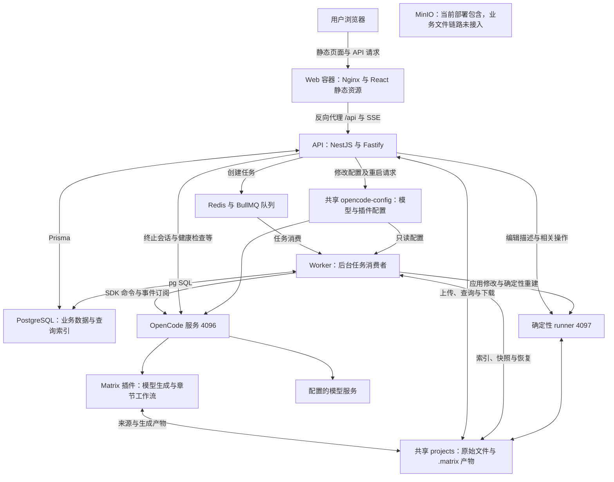
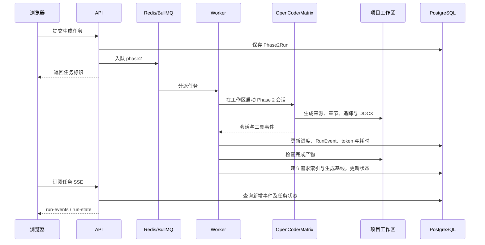
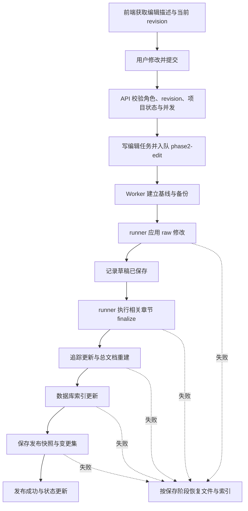

# requirements-manager 整体架构

## 1. 系统定位

requirements-manager 是围绕 Matrix Phase 2 测试需求文档生成构建的管理系统，提供项目导入、异步生成、原文与需求追踪、人工评审、在线编辑、版本历史及文档导出。

它与仓库根目录的 Matrix 插件分工如下：

- **管理系统**负责用户与项目、任务生命周期、数据索引、界面、评审记录、版本和发布管理。
- **Matrix 插件**负责从来源文档生成 Phase 2 章节数据、建立来源引用、校验和渲染章节、生成追踪表及合并总 DOCX。
- **OpenCode**承载插件与模型会话，执行需要语义理解的生成任务。
- **Matrix deterministic runner**独立提供编辑映射、修改应用和确定性重建 HTTP 接口；在线编辑不需要重新创建模型会话。

主产物是各章节 JSON/DOCX、覆盖追踪和 `phase2-test-requirements.docx`。管理系统直接使用章节产物，不依赖旧版统一需求生成链路。本工程与仓库其他单元测试、Phase 6 能力的范围不同。

本文以当前源码和 Compose 配置为准。代码位置用文件路径与关键模块名称标识，不固定行号。

## 2. 总体组件与连接

运行时有三个应用：Web、API、Worker。OpenCode 和 runner 在默认部署中位于同一个容器，但它们是不同进程、不同端口、不同执行职责。PostgreSQL、Redis、MinIO 是部署服务，不属于三个应用的源码模块。

**MinIO 的边界：** Compose 声明 MinIO 服务及数据卷，但当前应用源码中未发现接入其对象上传/读取的主链路。项目 ZIP、原始 DOCX、生成文件和历史快照均使用共享文件系统。`Document.objectKey` 当前保存的是本地文件路径，不能仅根据字段名推断为 S3 对象键。

## 3. 应用组件的组成与职责

### 3.1 Web：操作界面与交互状态

代码位于 `apps/web/`，由 React、Vite、Ant Design、React Query、React Router 和 Zustand 等组成。入口为 `src/main.tsx`，页面与业务交互主要集中在 `src/ui.tsx`。

| 组成 | 主要代码 | 功能 |
| --- | --- | --- |
| 应用入口与页面 | `main.tsx`、`ui.tsx`、`AppHeader.tsx` | 登录、项目列表、生成进度、评审工作区和页面导航 |
| API 与状态管理 | `api.ts`、`traceStore.ts`、各导航辅助模块 | 统一请求、查询缓存、选中需求及追踪导航 |
| 文档展示 | `DocxPreview.tsx`、`Phase2DocumentRenderer.tsx` | 原 DOCX 预览、正式章节结构展示、原文与需求联动 |
| 在线编辑 | `phase2Draft.ts`、`SortableTableList.tsx`、`tableOrder.ts` 及 `ui.tsx` 编辑流程 | 编辑稿、表格调整、提交和发布状态反馈 |
| 历史与监控 | `RequirementDiff.tsx`、`revisionDisplay.ts`、`runMetrics.ts`、`runLogDetails.ts` | 版本比较、运行日志、耗时与 token 使用展示 |
| 配置与诊断 | `SettingsModal.tsx`、`DebugFilesPanel.tsx` | 系统设置、工件查看与调试 |

浏览器经 `/api` 访问 API，携带登录 Cookie。生成运行及调试文件使用 EventSource/SSE；部分查询、编辑任务状态使用轮询刷新。前端没有直接连接 PostgreSQL、Redis 或模型服务，也不直接修改共享卷。

### 3.2 API：业务入口与权限边界

代码位于 `apps/api/`。`src/main.ts` 启动 NestJS/Fastify，注册 Cookie、multipart、CORS 和 `/api` 前缀；`src/modules.ts` 统一注册控制器、服务及全局认证 Guard。数据库经 `PrismaService` 访问，模型与迁移位于 `prisma/`。

| 业务组件 | 主要文件 | 职责 |
| --- | --- | --- |
| 认证与账号 | `auth.ts`、`settings.ts`、`seed.ts` | 登录、当前用户、改密、管理员创建账号及初始化 |
| 项目与导入 | `projects.ts`、`archive.ts`、`project-activity.ts` | ZIP 上传、安全解压、工作区定位、项目状态与删除保护 |
| 生成任务 | `runs.ts`、`run-clock.ts` | 创建/查询/取消任务、任务入队、事件推送与运行计时 |
| 文档与追踪 | `documents.ts`、`traceability.ts`、`phase2-document.ts` | 源文件下载、来源与需求关联查询、章节展示数据组装 |
| 评审 | `reviews.ts`、`review-summary.ts` | 评分、意见、评审版本及完成度汇总 |
| 在线编辑 | `phase2-edits.ts` | 获取可编辑字段、校验请求与版本、提交异步重建任务 |
| 历史与工时 | `requirement-revisions.ts`、`edit-time.ts` | 版本列表、历史查询、差异与编辑工时 |
| 导出与诊断 | `exports.ts`、`debug-files.ts` | 发布 DOCX、评审报告以及调试文件访问 |

API 是业务编排入口，但不在一次普通 HTTP 请求内执行整轮模型生成。长任务交给队列和 Worker。编辑字段描述等短请求可由 API 直接访问 runner，实际修改及重建由 Worker 执行。

### 3.3 Worker：异步执行、运行记录与索引维护

代码位于 `apps/worker/`，入口 `src/index.ts` 消费 BullMQ 队列，直接用 `pg` 访问与 API 共用的 PostgreSQL。

| 队列 | API 生产者 | Worker 消费者 | 主要工作 |
| --- | --- | --- | --- |
| `document-index` | `ProjectsService` | `index.ts` | 导入后建立原始文档与已有需求索引 |
| `phase2` | `RunsService`；Worker 自身可追加重试任务 | `index.ts` | 调用 OpenCode 生成、监听事件、维护阶段/日志/指标、建立最终索引与基线 |
| `phase2-edit` | `Phase2EditsService` | `phase2-edit.ts` 的 `startPhase2EditWorker` | 应用编辑、确定性重建、索引、发布版本与失败恢复 |

配套模块包括：

- `opencode-transport.ts`、`session-tasks.ts`：OpenCode HTTP 传输及会话命令/事件协作。
- `progress.ts`、`token-usage.ts`：将工具执行、章节完成和模型使用量转成运行信息。
- `retry-policy.ts`：决定可重试失败及输入指纹相关策略，避免把所有错误视为相同失败。
- `indexing.ts`：原文节点、正式需求节点和追踪关系的数据库投影。
- `requirement-revisions.ts`、`repair-requirement-history.ts`：基线、发布快照、变更集和历史维护。

### 3.4 OpenCode 与 Matrix：生成执行端

部署相关代码位于 `docker/opencode.Dockerfile`、`docker/opencode-entrypoint.sh`、`docker/opencode-healthcheck.mjs`。Matrix 插件源码位于仓库根目录的 `src/`、`skills/`、`templates/`，构建后随 OpenCode 镜像交付。

Worker 通过 OpenCode SDK 创建或控制会话，在项目目录执行 Phase 2 命令；OpenCode 承载模型调用与 task 委派，插件负责具体章节工作流。生成文件直接写到共享项目工作区，Worker 随后读取它们建立管理系统索引。

需要区分两种并发：Worker 的项目任务并发与 Matrix 内部章节 worker 的并发。它们位于不同层，不能用队列并发值推导模型子任务总量。

### 3.5 确定性 runner：编辑与重建执行端

runner 源码是仓库根目录 `src/direct-phase2-runner.ts`，使用 Node.js 启动，调用 Matrix 编辑映射和章节 finalize 能力。管理系统通过 `MATRIX_PHASE2_RUNNER_URL` 访问它。

其职责是查询可编辑对象、应用 raw 修改、执行允许的章节收尾、更新追踪和重建总文档。它使用 Basic Auth、项目目录范围及 mode 白名单约束。它不是第二个模型调度服务。

容器入口同时维护 OpenCode 和 runner：OpenCode 退出可由脚本重新启动；runner 退出会使容器退出，防止只有模型端可用、编辑端失效的状态。是否自动重启整个容器还取决于部署配置，不能仅凭入口脚本推断。

## 4. 核心业务流程与组件交互

### 4.1 项目导入与文档索引

1. 浏览器上传 ZIP，API 建立 Project，流式写入 `PROJECTS_ROOT/<projectId>/upload.zip`。
2. `safeExtract` 解压到 `source/`。当前项目导入采用 `docxOnly:true`：仅接受 DOCX 文件，拒绝导入现成 `.matrix`，并检查文件数量、解压大小、路径穿越和符号链接等。
3. API 定位项目工作区，更新 `workspacePath`，设置 `PENDING_GENERATION` 并记录缺少的 Phase 2 工件。
4. API 把项目 ID 与工作区路径写入 `document-index` 队列。
5. Worker 的 `indexProject` 读取原始 DOCX，建立 Document/DocumentNode；若目录中有可用章节产物，再建立对应需求及追踪索引。

原文展示索引可以先于模型生成建立。它是管理系统的独立文档索引功能，不等于 Matrix `prepare_document_artifacts` 的来源准备过程，也不代表测试需求已生成。

### 4.2 异步生成、事件与进度

Worker 会按已完成章节增量更新可用需求索引，最后检查生成完成条件、执行完整索引、保存 `GENERATED_BASELINE`，再将项目设为 `READY_FOR_REVIEW`。因此“有些章节已能查看”和“整轮生成完成”是不同状态。

SSE 是 API 面向浏览器的通道。`RunsService.events` 当前按周期查询数据库事件及任务状态，再形成 SSE；不是 Redis 消息直接推送到浏览器，也不是浏览器直连 OpenCode 事件流。

任务失败记录失败阶段和原因；符合条件时由重试策略再次入队。取消由 API/Worker 的任务状态与 OpenCode 会话终止共同处理。Worker 还有启动后针对残留 RUNNING 任务及缺失索引的恢复检查，复用既有产物；这不等于多节点、所有故障下的 exactly-once 保证。

### 4.3 需求查询与来源追踪

`indexing.ts` 把 `.matrix/data` 各章节 JSON 和追踪工件投影为数据库中的 TestRequirementNode/TraceLink。来源 DOCX 另被索引为 Document/DocumentNode。

API 的 `TraceabilityService.reviewData` 聚合原文节点、需求节点、追踪关系、运行信息，并用 `buildPhase2Document` 组装正式章节展示模型。浏览器据此实现目录、需求内容和来源文档的联动；原 DOCX 从 `DocumentsController` 读取共享文件路径后流式返回。

查询索引包含 `businessId`、`entityUid`、`sourceRefs`、父子关系、顺序和来源工件，用来连接需求身份、界面导航和历史。重新索引时会考虑评审节点迁移与编号变化，不能把它视为无条件清空全部业务历史。

### 4.4 人工评审与导出

评审以项目内的需求节点为对象，API 保存评分、意见、评审人和版本号，并关联当前发布需求版本及实体标识。新评审产生新的 Review 记录，历史记录和失效标识用于保留上下文。

人工评分属于管理系统的业务评审，不能自动等同于 Matrix 插件阶段钩子的 PASS/REVISE，二者的数据模型和执行位置不同。

导出有不同来源：

- **测试需求 DOCX**：读取项目已生成的总文档，并流式下载；下载名称中的“第三方测试需求”不表示重新调用已删除的旧导出工具。
- **评审报告**：API 从需求、评审及编辑工时组装报告数据，使用自己的评审报告模板生成。
- **历史版本 DOCX**：版本接口读取对应发布快照。

当前总 DOCX 下载在 `REBUILDING` 时可从备份返回上一发布版本，并带 previous 标记；没有可用备份则拒绝下载。评审报告在重建时拒绝导出。因此不能笼统描述为“重建时所有下载都禁止”。

### 4.5 在线编辑与版本发布

编辑依赖 `expected_revision` 检测过期提交，同时检查项目状态和活动任务，并通过数据库事务记录编辑与状态变更。普通发布包含 raw 修改、章节重建、追踪、总 DOCX、索引和发布快照；没有成功执行全部步骤时不能把草稿视为新发布版本。

当前实现区分以下情况：

- 应用修改前失败：恢复操作前状态。
- 修改已保存但发布失败：保留编辑稿状态，恢复上一发布结果，任务标记 `PUBLISH_FAILED`，可以据保存上下文继续发布。
- 生成期间允许的编辑分支：重建相关章节并更新可用需求索引，后续分析与完整发布延后，不立即执行普通发布的全部步骤。

因此“生成期间一律不可编辑”以及“任一失败都丢弃已保存草稿”都不符合当前代码。具体可操作范围由 API 和 Worker 对生成状态、目标工件及编辑任务的检查决定。

## 5. 数据职责与一致性

### 5.1 数据存放在哪里

| 数据位置 | 存放内容 | 主要读写方 | 边界 |
| --- | --- | --- | --- |
| 共享 `projects` 卷 | ZIP、DOCX、工作区、`.matrix/data`、报告和历史文件 | API、Worker、OpenCode、runner | 生成与重建所依赖的文件实体 |
| PostgreSQL | 项目/账号、运行、索引、评审、版本元数据、审计 | API 用 Prisma；Worker 用 pg | 查询索引可重建，评审与审计等业务记录不可简单从 JSON 推导 |
| Redis | BullMQ 队列、任务调度状态 | API 与 Worker | 不存放正式章节正文，也不替代业务运行记录 |
| `opencode-config` 卷 | 模型/插件配置、配置重启协调文件 | API 写；OpenCode 读；Worker 只读 | 属于执行端配置，不是项目产物 |
| MinIO 卷 | 部署提供的对象存储空间 | 当前主业务文件链路未接入 | 不能当成现有原始文档或报告的实际存储位置 |

`.matrix/data/*.raw.json` 是模型或人工编辑的输入边界；正式章节 JSON/DOCX 是确定性发布结果；数据库节点是管理系统的查询投影。数据库也承载评审和历史等独立业务数据，所以“全部 PostgreSQL 数据都可以从工作区恢复”是不成立的。

### 5.2 数据模型分组

模型集中定义在 `apps/api/prisma/schema.prisma`：

| 分组 | 主要模型 | 用途 |
| --- | --- | --- |
| 用户与项目 | User、Project | 身份、角色、工作区与项目状态 |
| 来源文档 | Document、DocumentNode | 文件路径、解析状态、原文结构与定位 |
| 测试需求与追踪 | TestRequirementNode、TraceLink | 需求树、稳定实体身份、原文关联 |
| 生成运行 | Phase2Run、RunEvent | 排队/运行/终止状态、阶段、事件、耗时和使用量 |
| 编辑运行 | Phase2EditRun | 编辑请求、预期版本、保存/发布状态、备份与错误 |
| 评审 | Review | 人工评分、意见、版本关联与失效记录 |
| 需求版本 | RequirementRevision、RequirementChangeSet | 生成基线、发布快照、版本元数据与差异 |
| 工时与审计 | EditTimeSegment、AuditLog | 编辑时间和关键操作留痕 |

### 5.3 事务、快照和故障恢复

`indexProject` / `indexAvailableRequirements` 在数据库事务内锁定 Project 行后更新索引。前者可更新原文与需求，后者只更新当前可用需求，避免每完成一个章节就使原文预览缓存失效。

编辑备份位于 `.matrix/history/rollback/<runId>/`，发布版本位于 `.matrix/history/revisions/<revisionId>/`。版本系统组合文件快照与数据库索引快照，用于历史查看和版本比较；备份用于失败恢复，二者职责不同。

文件写入、数据库事务和 Redis 入队不属于一个跨系统原子事务。代码用失败标记、恢复、再次索引及入队失败处理协调一致性。备份或恢复本身失败时项目可进入 FAILED；不能描述成任意情况下都自动恢复成功。

同项目状态、版本校验与事务锁是关键协调手段。若计划水平扩容 API/Worker/OpenCode，需要另行评估共享路径、进程恢复检查、项目任务互斥和跨服务版本兼容，当前 Compose 不是完整高可用集群设计。

## 6. 部署拓扑、配置与交付

### 6.1 默认 Compose 部署

默认 `docker-compose.yml` 声明七个服务：postgres、redis、minio、opencode、api、worker、web。

| 服务 | 默认容器端口与访问方式 | 源码/构建来源 |
| --- | --- | --- |
| Web | 80，默认映射主机 8080 | `docker/app.Dockerfile` 的 web 阶段及 `docker/nginx.conf` |
| API | 3000，默认映射主机 3000 | `apps/api` |
| Worker | 无对外 HTTP 端口 | `apps/worker` |
| OpenCode | 4096，供 API/Worker 在容器网络访问 | `docker/opencode.Dockerfile` |
| runner | 4097，与 OpenCode 同容器，内部访问 | 根工程 `dist/direct-phase2-runner.js` |
| PostgreSQL | 5432，默认 Compose 映射主机 5432 | PostgreSQL 服务镜像 |
| Redis | 6379，默认 Compose 无主机端口映射 | Redis 服务镜像 |
| MinIO | 对象服务默认 9000；控制台 9001 默认映射主机 | MinIO 服务镜像 |

Nginx 提供 SPA 静态资源并将 `/api/` 代理至 API，关闭代理缓冲以支持长连接/SSE。浏览器正常只需访问 Web 地址；开发环境由 Vite 的代理配置承担相应入口转发。

API 镜像启动时执行 Prisma migration 和 seed，再启动服务。OpenCode 镜像从仓库根目录构建并携带 Matrix 插件、技能、模板及 runner。升级不能仅替换前端或仅更新数据库而忽略执行端产物版本。

### 6.2 共享卷与配置通道

- `projects`：挂载到 API、Worker、OpenCode 的同一 `/data/projects`，runner 在 OpenCode 容器内访问相同路径。数据库 `workspacePath` 的可用性依赖各服务对路径的一致理解。
- `opencode-config`：OpenCode 使用其配置目录；API 挂载为配置管理路径；Worker 只读挂载。API 更新配置并写重启请求，入口脚本检测后重启 OpenCode，并写应用确认。
- `postgres-data`、`redis-data`、`minio-data`：分别持久化对应服务数据；保存项目资料不能只备份数据库而忽略 projects 卷。

关键配置可按职责理解：数据库/Redis 地址，`PROJECTS_ROOT`，`OPENCODE_URL` 与 Basic Auth，`MATRIX_PHASE2_RUNNER_URL`，模型配置路径，以及 JWT/Cookie 和上传限制。真实密码或模型密钥不应放入架构文档。

### 6.3 在线构建与 ARM64 离线交付

| 目录/文件 | 用途 |
| --- | --- |
| `docker/` | 应用与执行端镜像、Nginx、进程入口和健康检查 |
| `docker-compose.yml` | 默认按源码构建的开发/部署组合 |
| `docker-compose.offline-arm64.yml` | 使用 ARM64 本地镜像标签、健康检查和重启策略的离线组合 |
| `scripts/build-arm64-offline.ps1` | 离线镜像及交付包构建入口 |
| `offline/` | 离线启动/运维脚本和部署说明 |
| `release/` | 本地交付产物目录，不是独立业务服务 |

离线部署仍是上述逻辑组件，默认 Web 入口端口与在线配置不同，应以离线 Compose/部署说明为准。离线指服务器可使用预置镜像和依赖；模型生成仍需访问已配置的内部模型服务，不能解释为无需模型执行端。

根 `package.json` 声明 npm workspaces `apps/*` 与 `packages/*`，当前目录中实际存在三个 apps，没有实现中的 packages 共享包层。共享能力更多表现为共同数据库约定、文件工件契约及对根 Matrix 工程的依赖。

## 7. 权限、运行边界与架构注意点

- API 注册全局 AuthGuard，使用 JWT Cookie；登录密码由 Argon2 校验。角色包含 ADMIN/REVIEWER/VIEWER，管理员设置及部分编辑操作有显式角色检查。不能由枚举存在推断所有接口已实施完整 RBAC。
- 项目路径、索引主键与查询按 projectId 区分，但 Project 没有用户所有权/租户关系；当前不是完整的多租户资源授权模型。
- runner 与 OpenCode 使用 Basic Auth，执行目录限制与 mode 白名单位于执行端；浏览器不直接获取对它们的完整操作权限。
- 状态有多个层次：Project 是业务可用性，Phase2Run 是生成运行，Phase2EditRun 是编辑及发布，RequirementRevision 是版本。不能把某一层的“成功”当作所有其他层都成功。
- 原文索引解析器与 Matrix 来源解析器是不同组件，可能有不同章节/段落定位方式；追踪通过来源引用与索引匹配连接，不宜假定两个目录输出逐项完全相同。
- MinIO 仍被 Compose 的依赖与部署包包含，但当前主业务实际依赖共享文件系统；这是现状说明，不表示已完成对象存储迁移。
- 健康检查、进程重启、任务恢复和数据库事务解决不同问题，不能互相替代。开发 Compose 与离线 Compose 的启动条件、对外端口和 restart 策略也不完全相同。

## 8. 维护与代码导航

以下路径相对于 requirements-manager 目录；文件名足以定位组件，再按表中类名/函数名搜索具体入口。

| 要理解的问题 | 起点 |
| --- | --- |
| 浏览器页面如何组织 | [Web 页面](../apps/web/src/ui.tsx)、[入口](../apps/web/src/main.tsx)、[请求封装](../apps/web/src/api.ts) |
| API 有哪些业务组件 | [AppModule](../apps/api/src/modules.ts)、[服务入口](../apps/api/src/main.ts) |
| 项目导入与工作区创建 | [ProjectsService](../apps/api/src/projects.ts)、[safeExtract](../apps/api/src/archive.ts) |
| 任务如何创建与反馈 | [RunsService](../apps/api/src/runs.ts)、[Worker 主入口](../apps/worker/src/index.ts) |
| 原文、需求、追踪如何入库 | [indexProject / indexAvailableRequirements](../apps/worker/src/indexing.ts)、[数据模型](../apps/api/prisma/schema.prisma) |
| 页面如何获得完整章节数据 | [TraceabilityService](../apps/api/src/traceability.ts)、[buildPhase2Document](../apps/api/src/phase2-document.ts) |
| 编辑如何应用和发布 | [Phase2EditsService](../apps/api/src/phase2-edits.ts)、[startPhase2EditWorker](../apps/worker/src/phase2-edit.ts) |
| 历史与评审如何维护 | [版本创建](../apps/worker/src/requirement-revisions.ts)、[版本查询](../apps/api/src/requirement-revisions.ts)、[评审](../apps/api/src/reviews.ts) |
| 文件与报告如何下载 | [原始文档](../apps/api/src/documents.ts)、[导出](../apps/api/src/exports.ts) |
| 配置如何作用于执行端 | [SettingsController](../apps/api/src/settings.ts)、[OpenCode 入口脚本](../docker/opencode-entrypoint.sh) |
| 服务如何部署 | [默认 Compose](../docker-compose.yml)、[离线 Compose](../docker-compose.offline-arm64.yml)、[Nginx](../docker/nginx.conf) |

相关文档与外部组件源码：

- [Phase 2 在线编辑与确定性重建](phase2-online-editor.md)：编辑服务、部署与恢复相关说明；涉及状态和失败行为时，以当前 `phase2-edit.ts` 为准。
- [Matrix Phase 2 整体架构](../../docs/phase2-arch.md)：章节生成模块、并行边界与文档发布。
- [Phase 2 文档解析与切片](../../docs/phase2-parsing.md)：来源准备、标题切片与表格绑定算法。
- [Matrix runner 源码](../../src/direct-phase2-runner.ts)：确定性执行端的 HTTP 与安全边界。
- [离线部署说明](../offline/README-OFFLINE.md)：目标服务器与交付包操作。

本次仅整理现有架构，不提出接口、数据模型或部署方式的变更。若后续拆分服务或改用对象存储，应同时评估文件契约、数据库索引、历史快照、下载及失败恢复的变化。
